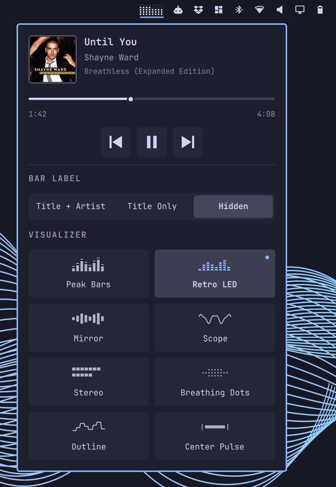

# Konobeat

Part of **Konochi**, a personal Omarchy plugin series by Alec Xu.

## Preview



## Features

- Appears when an MPRIS player exposes a song title or artist; hidden when no
  media metadata is available. Enabling the plugin alone does not force an icon.
- Bar text can show `song - artist`, song only, or be hidden. Long metadata scrolls.
- Left click the bar widget: open/close the panel. Click outside to dismiss.
- No right-click action or hover-to-open behavior. Playback controls are in the panel.
- The panel offers three text formats and eight effect cards, each with a static
  thumbnail and a selected-state accent dot. Changes apply immediately and persist.
- Playing: the selected visualizer at full opacity. Paused: the visualizer is
  hidden and replaced by a rounded play icon at 50% opacity. The slot shrinks
  to the 16px icon width rather than reserving the visualizer width. Bar padding
  is 5px per side, with a 4px gap before visible text. Short/hidden labels do not
  reserve unused text width. The icon still opens the panel on left click.
- Panel: artwork, metadata, controls and source selection. Long song and artist
  fields scroll independently while open. Effect thumbnails are illustrations,
  not additional live visualizers. Small screens can scroll the panel vertically.
- When valid MPRIS duration and position are available, a timeline with elapsed
  and total time appears between metadata and transport controls. Seeking is
  enabled only if the player supports it; dragging commits once on release.
  Unknown/live-stream lengths are hidden. Position is refreshed while open.
- Transport controls use equal 40px hitboxes and consistent 22px vector icons.
- Middle click and wheel retain the original next/previous track controls.

Settings in the `konochi.konobeat` layout entry of `shell.json`:

- `rhythmStyle`: `peak` (default), `led`, `wave`, `scope`, `stereo`, `breathing-dots`,
  `outline`, `center-pulse`.
  Legacy `bass-ring` settings automatically select Breathing Dots.
- `labelFormat`: `song-artist` (default), `title`, `none`. Hiding bar text does
  not hide the widget's visualizer or metadata in the panel.
- `maxWidth`: total horizontal width, default 220 logical pixels, minimum 120.
- `visualizerWidth`: default 32 logical pixels, configurable from 24 to 80.
  At the default size, 16 sampled frequency bands merge into 8 visible columns;
  sampling resolution is unchanged and the saved width is available to text.

## Real audio

`Service.qml` runs one shared `audio_sampler.py` helper during media playback.
The helper uses the existing `pw-cat` tool to capture the **default output sink's
monitor**, not the microphone. It needs only Python's standard library. Raw audio
stays in memory; no recordings are saved. Other sounds on the same output also
affect the visualizers. With automatic PipeWire routing, output-monitor selection
follows the session manager's default device policy.

Stereo float PCM at 24 kHz is analyzed in 1024-sample blocks (~23 frames/second).
A Hann-windowed FFT supplies 16 logarithmic bands for peak, LED and mirrored
spectrum and outline modes. Stereo meters use independent L/R RMS levels and
sample peaks (upper strip: left; lower: right). Their -48 to 0 dBFS mapping
uses an expanded middle range, faster release and short peak holds so typical
music does not pin the display near full scale. Breathing Dots is a fixed 9x3
grid: measured 45–174 Hz bass energy increases/decreases the number of lit dots
from the center outward, without changing spacing or dot size. Its bar viewport
is only 12px high. Unclipped linear bass amplitude is compared with a slow local average
so constant loud bass settles at a modest count; transient peaks reveal the
outer dots. A silence floor prevents quiet noise from being amplified. The
response ranges from 1 to 27 lit dots.
The visualizer is hidden on pause. It is not a timed animation.
The oscilloscope uses
zero-crossing-aligned raw PCM samples from the mono mix,
not synthesized frequency data. The QML renderer smooths levels and peak decay
at about 30 FPS. Sampling stops on pause; failed capture is retried automatically.
Center Pulse expands symmetrically with measured channel volume and retains
falling peak markers.

`Marquee.qml` is shared by the bar and panel. `Visualizer.qml` renders the sampled
audio. The former `Rhythm.qml` remains unused for reference. The packaged
`omarchy.media` plugin is unchanged. Backups are under `/tmp/opencode/`.

Test DSP without audio: `python3 -B -m unittest test_audio_sampler.py`

Test a finite real capture: `python3 -B audio_sampler.py --frames 5`

## Install and remove

Requires Omarchy Quattro, Python 3 (standard library only), PipeWire's `pw-cat`,
and an MPRIS-compatible media player. No privileged setup or extra system service.
This is a standalone plugin derived from Omarchy Media, not a development clone.
Disable the stock widget to avoid duplicate controls and media notifications.

```sh
omarchy plugin add https://github.com/xvvhang/omarchy-konobeat-plugin --enable
omarchy plugin disable omarchy.media
```

Restore the stock widget when uninstalling:

```sh
omarchy plugin disable konochi.konobeat
omarchy plugin enable omarchy.media
omarchy plugin remove konochi.konobeat
```

No audio is written to disk; settings remain in the shell configuration unless
removed there. Back up unpushed development changes before plugin removal.

## Validation

```sh
omarchy plugin validate .
/usr/lib/qt6/bin/qmllint -I /usr/share/omarchy/shell ./*.qml
python3 -B -m unittest discover -v
```

Use Qt 6's qmllint (the default executable may be Qt 5).
MIT licensed; includes Omarchy-derived components, attributed in LICENSE.
